<div align="center">


<br/>

[](https://ddash-by-devdynamo.vercel.app/)


**A multi-tenant business dashboard you can sell.**
Businesses register, add their team, watch live charts and receive automatic weekly and monthly reports.

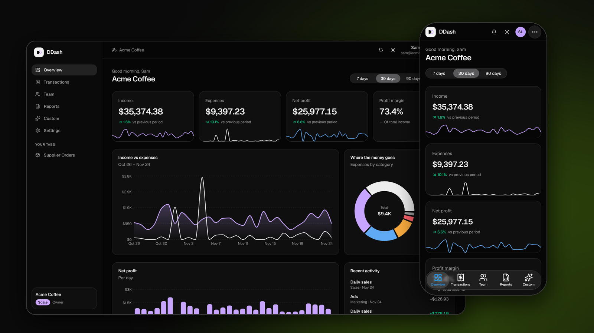

</div>

---

## Contents

[What is DDash?](#what-is-ddash) · [Features](#features) · [Screenshots](#screenshots) · [Plans](#plans) · [Custom tabs](#custom-tabs-built-by-you) · [Push notifications](#push-notifications) · [Architecture](#architecture) · [Data model](#data-model) · [Getting started](#getting-started) · [SEO](#seo) · [Project layout](#project-layout) · [Roadmap](#roadmap)

---

## What is DDash?

DDash (**D**ev**D**ynamo **Dash**board) is a software-as-a-service product for small and medium businesses. One platform serves many businesses at once. Each business has its own private workspace, team, data and reports.

> **The idea:** a business owner registers in under a minute, adds their employees, and from then on gets a clear picture of income, expenses and profit without touching a spreadsheet.

<table>
<tr>
<td width="50%">

**For business owners**

- Register a business, pick a plan, start on the free tier
- Add admins and employees, each with their own login
- Track income and expenses, see profit at a glance
- Receive weekly and monthly reports automatically
- Pick a colour theme and light or dark mode

</td>
<td width="50%">

**For the developer (you)**

- A private **Dev console** at `/dev`
- Build custom tabs from scratch with a live preview
- Read and answer customer upgrade requests
- Send push notifications to everyone or one business
- See every business on the platform

</td>
</tr>
</table>

---

## Features

| | Feature | Details |
|---|---|---|
| 📊 | **Animated charts** | Income vs expenses area chart, expense donut, daily profit bars, KPI sparklines, with 7, 30 and 90 day ranges |
| 🧾 | **Transactions** | Add, search, filter and delete. CSV export. Sample data in one click |
| 👥 | **Team and roles** | Owner, admin and employee roles. Plan-based team limits |
| 🔑 | **Employee login page** | Each business gets its own branded sign-in link, which the owner can switch off |
| 📑 | **Reports** | Reports with print or save as PDF and CSV download. Custom date ranges on Scale |
| ⏰ | **Automatic reports** | Weekly (last Monday to Sunday) and monthly (last full month), generated by a daily cron job, never duplicated |
| 💳 | **Plans** | Starter, Growth and Scale with feature gating, Renew, Upgrade or Downgrade buttons, and cancel to the free plan |
| 🧩 | **Custom tabs** | Growth gets 3 and Scale gets 5 custom upgrades, built by the developers. More can be bought |
| 🔔 | **Push notifications** | Developer to customers, with an inbox and optional action buttons |
| 🎨 | **Nine accent colours** | Buttons, focus rings and chart accents all follow the chosen colour |
| 🌗 | **Light and dark mode** | Follows the system or the toggle, including the Glisse components |
| 📱 | **Mobile first** | Glass tab bar on phones, tested at 390px |
| 🔍 | **SEO ready** | Sitemap, robots, Open Graph image, JSON-LD structured data |

---

## Screenshots

<div align="center">

### Landing page

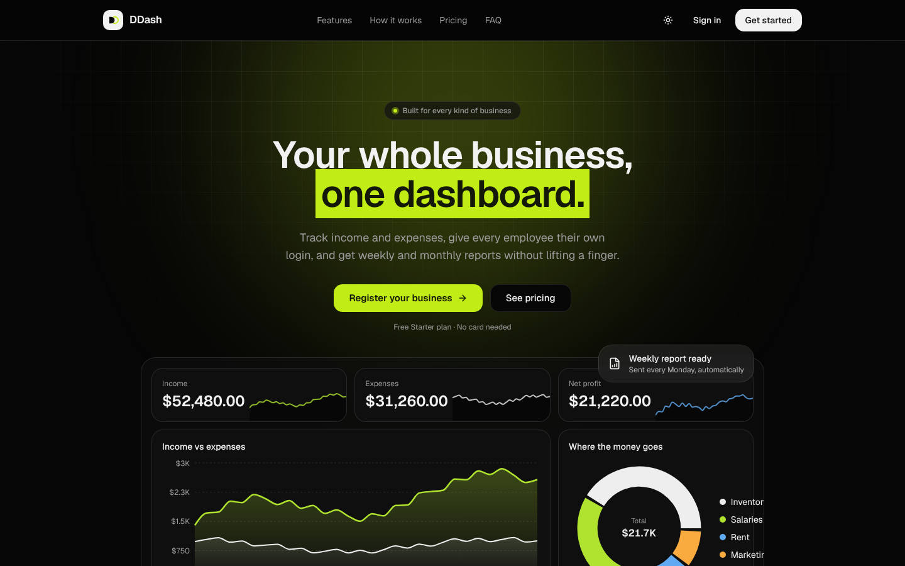

### Dashboard (dark and light)

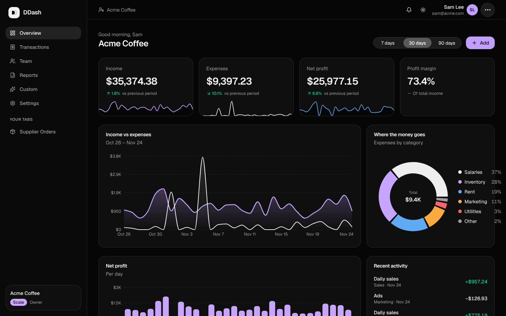 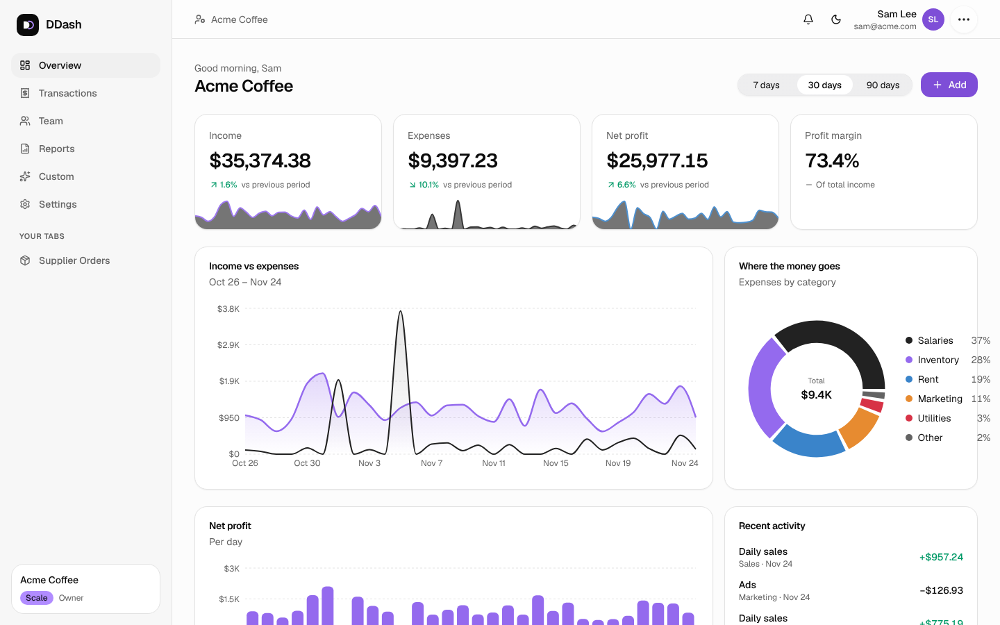

### Transactions and reports

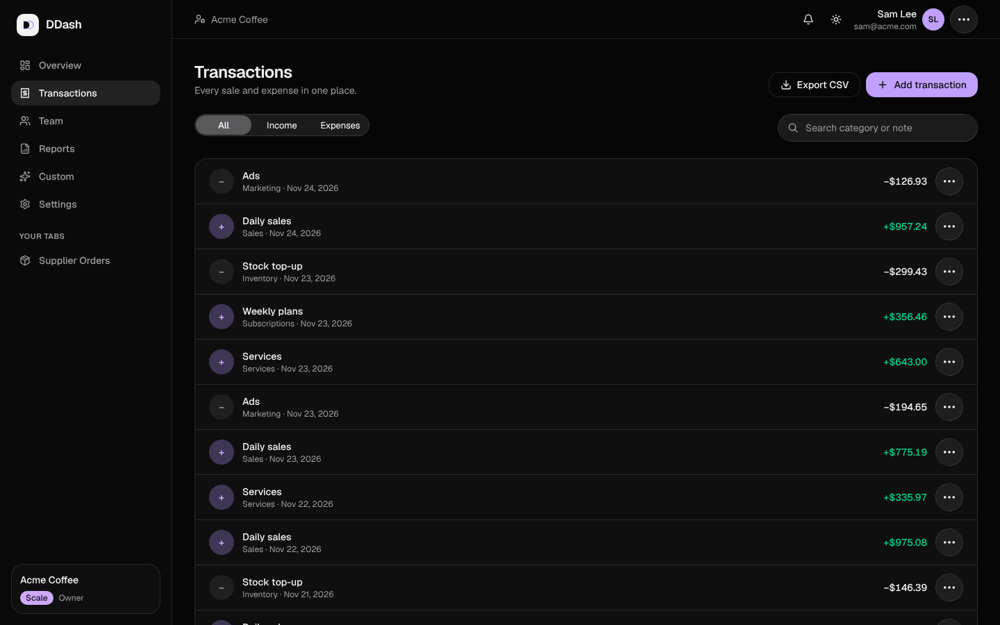 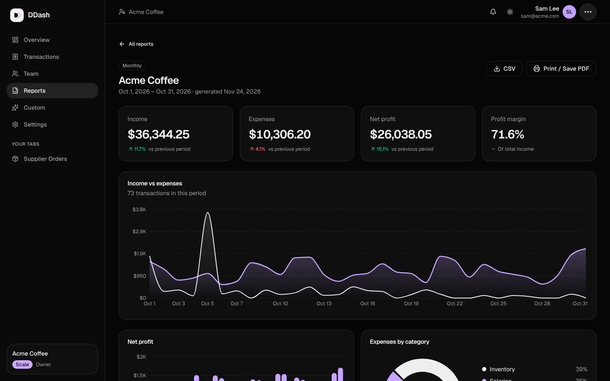

### A custom tab, built from scratch by the developer

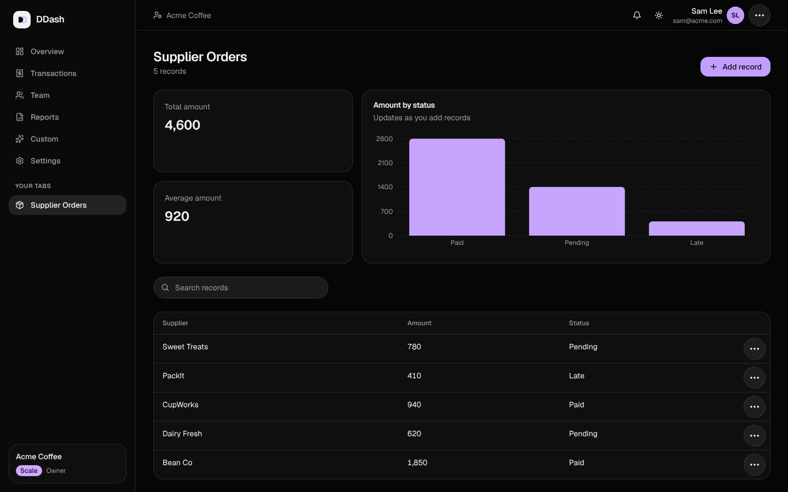

### Settings: themes, accent colours and subscription

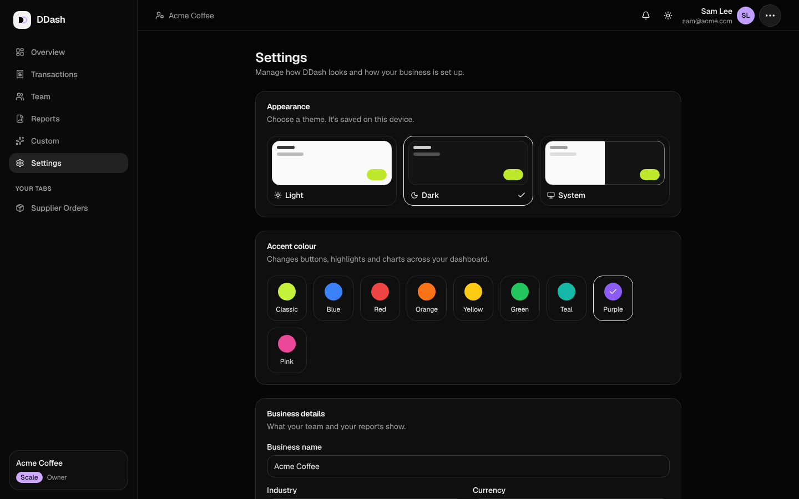

### Pricing

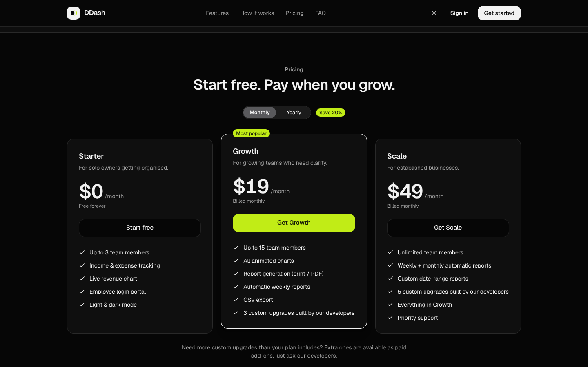

### Developer console

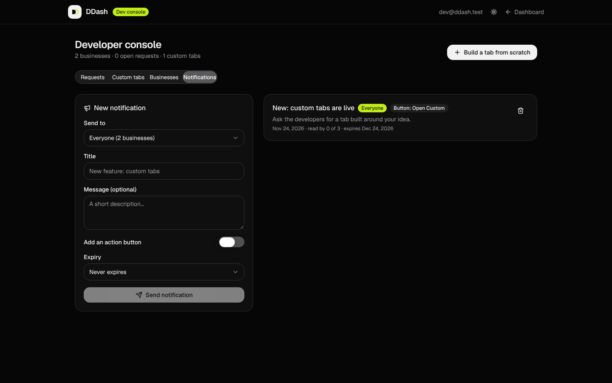

### On a phone

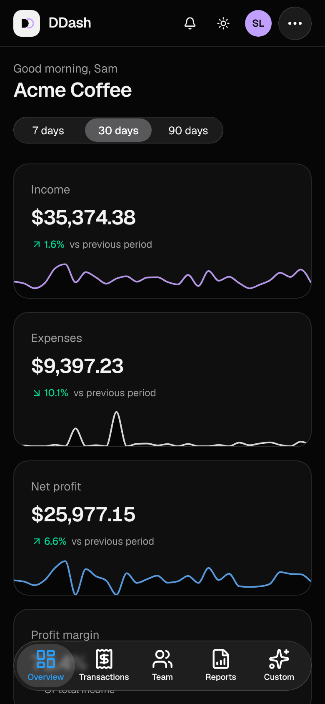 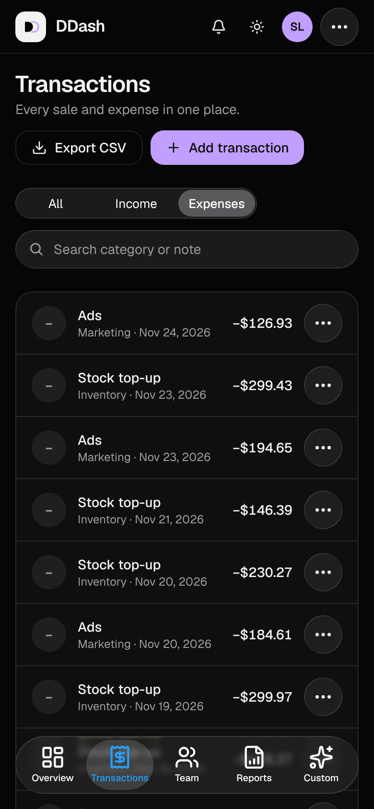

</div>

---

## Plans

| | **Starter** | **Growth** | **Scale** |
|---|:---:|:---:|:---:|
| Price | Free | $19 / month | $49 / month |
| Team members | 3 | 15 | Unlimited |
| Income and expense tracking | ✅ | ✅ | ✅ |
| Live revenue chart | ✅ | ✅ | ✅ |
| All animated charts | | ✅ | ✅ |
| Reports (print or PDF) | | ✅ | ✅ |
| CSV export | | ✅ | ✅ |
| Automatic weekly reports | | ✅ | ✅ |
| Automatic monthly reports | | | ✅ |
| Custom date-range reports | | | ✅ |
| Employee login page | ✅ | ✅ | ✅ |
| **Custom upgrades (built by you)** | | **3** | **5** |
| Priority support | | | ✅ |

Yearly billing is 20% cheaper. Signed-in owners see **Renew**, **Upgrade** or **Downgrade** on the pricing cards. Cancelling a subscription moves the business to Starter straight away. A downgrade is blocked while the team is larger than the new plan allows.

> The table summarises `src/lib/plans.ts`, which is the single source of truth.

---

## Custom tabs built by you

Customers on **Growth** and **Scale** can ask for a tab built around their own idea ("Want a custom tab with your idea? Contact the developers!"). You build it in the Dev console. No code changes and no redeploy.

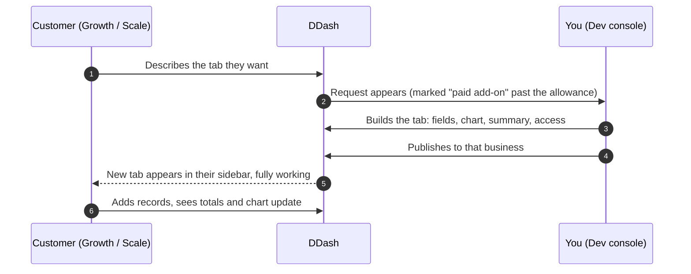

A **data tab** gives the customer a working form, table, search, summary cards and a chart. You define the fields (text, long text, number, date, dropdown, checkbox), the number to total, and the chart (bars, donut or line). An **info page** shows formatted text and links.

---

## Push notifications

Send a message to **every business** or to **one business**, with or without an action button.

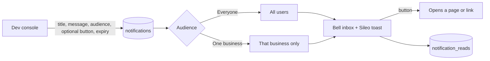

- Customers see a bell with an unread count, plus a toast the first time a new message arrives.
- **People who sign up later also receive notifications that are still active.**
- Each person has their own read state. The console shows "read by X of Y".
- Action buttons only accept in-app paths or `https://` links.

---

## Architecture

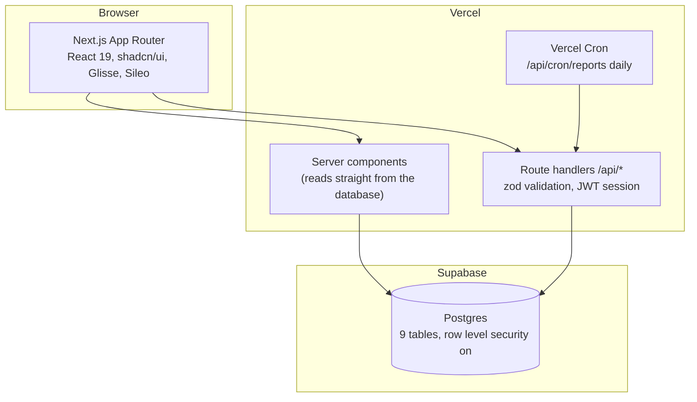

**Design choices**

- **Own auth, not a third-party widget.** `bcryptjs` hashes passwords. A signed JWT (`jose`) lives in an httpOnly cookie. Roles are owner, admin and employee.
- **Direct Postgres.** The app talks to Supabase Postgres through `pg` and the transaction pooler. Row level security is on with no public policies, so the database cannot be read from the browser with the public key.
- **Transactions where it matters.** Plan changes lock the business row and check team limits in one transaction.
- **Idempotent cron.** Reports are keyed by `(business_id, key)`, so running the job twice never creates duplicates.
- **Safe custom tabs.** Developer-defined configs are validated by the same code that builds the form, and rendered as data, never as code.

---

## Data model

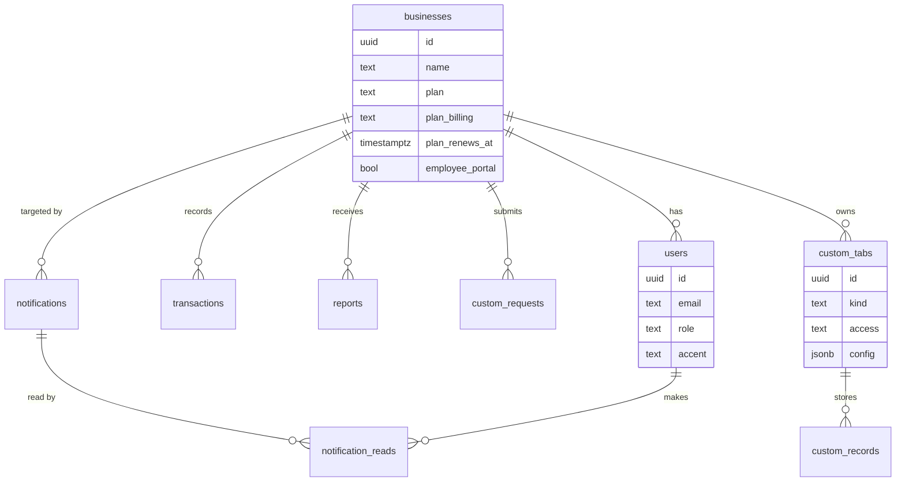

<div align="center">
</div>

---

## Accent colours

<div align="center">
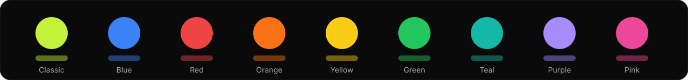
</div>

---

## SEO

The landing page is built to be found:

- A descriptive title and description, canonical address and keyword set
- **Open Graph and Twitter share card** generated at `/opengraph-image`
- **Structured data (JSON-LD)** for the software, its prices and the FAQ, which can earn rich results in Google
- `sitemap.xml` and `robots.txt`, with private pages (dashboard, dev console, team sign-in) kept out of search
- `manifest.webmanifest` so the app can be installed on a phone

After deploying, submit `https://your-domain/sitemap.xml` in Google Search Console. A custom domain, a few backlinks (your portfolio, GitHub, social profiles) and regular helpful content do more for ranking than any single setting.

---

## Project layout

```
supabase/
  schema.sql                 all tables, indexes and row level security
  migrations/                small upgrade scripts for existing databases
src/
  app/
    page.tsx                 landing page with JSON-LD
    login, register, b/[slug]
    dashboard/               overview, transactions, team, reports, settings, custom tabs
    dev/                     developer console and tab builder
    api/                     auth, plan, transactions, reports, custom, notifications, cron
    sitemap.ts  robots.ts  manifest.ts  opengraph-image.tsx
  components/
    ui/                      shadcn-style Select, Popover, Calendar, Dialog, ...
    dashboard/               shell, charts, stat cards, notification centre
    custom/  dev/            custom tab runtime and the builder
    landing/                 hero, features, pricing, FAQ
  lib/
    db.ts  sql.ts            every query, in one place
    plans.ts  custom.ts      plan rules and the custom tab config
    auth.ts  site.ts  accent.ts
docs/                        README images
```

---

## Roadmap

- [x] Multi-tenant workspaces, roles and employee login pages
- [x] Animated charts, reports and automatic weekly and monthly reports
- [x] Plans, renew, upgrade and cancel
- [x] Supabase backend
- [x] Developer console, custom tab builder, push notifications
- [x] Nine accent colours, light and dark mode, mobile layout
- [x] SEO: sitemap, structured data, share cards
- [ ] Payment provider (Stripe or a local gateway)
- [ ] Email delivery of reports
- [ ] Browser push notifications when the app is closed
- [ ] More languages

---

<div align="center">

**Built by [DevDynamo](https://dev-dynamo-official.vercel.app)** · DD = DevDynamo

<sub>DDash is a product of DevDynamo. All rights reserved unless a licence file says otherwise.</sub>

</div>
